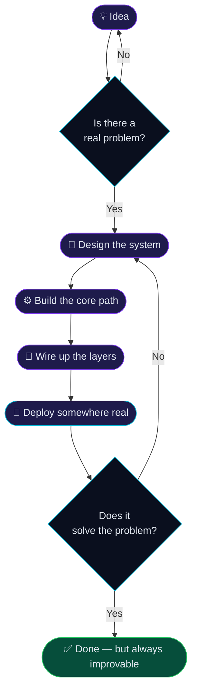

<!-- ═══════════════════ HEADER ═══════════════════ -->
<p align="center">
  
</p>

<p align="center">
  
</p>

<p align="center">
  <a href="https://arpit-mhjn1.github.io/arpit-portfolio/">
    
  </a>
  <a href="https://www.linkedin.com/in/arpitmahajan10">
    
  </a>
  <a href="mailto:mahajanarpit37@gmail.com">
    
  </a>
  <a href="https://arpit-mhjn1.github.io/arpit-portfolio/resume.pdf">
    
  </a>
</p>

<p align="center">
  
  &nbsp;
  
  &nbsp;
  
</p>

---

## `$ arpit --whoami`

```bash
{
  "name"       : "Arpit Mahajan",
  "title"      : "Aspiring Software Engineer",
  "location"   : "India 🇮🇳",
  "open_to"    : ["Internships", "SWE Roles", "Collaborations"],

  "i_build"    : ["AI-powered web apps", "Spring Boot backends", "ML pipelines"],
  "i_use"      : ["Python", "Java", "JavaScript", "SQL"],
  "i_deploy_on": ["Render", "Vercel", "GitHub Pages", "Streamlit Cloud"],

  "currently"  : "Deepening Java/Spring Boot + exploring LangChain & RAG",
  "philosophy" : "Ship it → learn from it → make it better.",
  "fun_fact"   : "My commit history tells more stories than my diary 📖"
}
```

---

## 🧭 My engineering mindset



> I don't start with the fanciest tool — I start with the clearest problem definition. The tech stack follows the problem, not the other way around.

---

## 🚀 Projects that ship

<div align="center">

| | Project | The problem it solves | Stack | Live |
|:-:|:--------|:---------------------|:------|:----:|
| 🤖 | **AI Interview Coach** | Mock interviews are generic. This one adapts to your *exact* target role using Groq Llama 3 — and tells you *why* your answer was weak. | `Python` · `Streamlit` · `Groq LLM` | [↗ Demo](https://ainterviewpreperation.streamlit.app/) |
| 🔥 | **Forest Fire Predictor** | Algerian meteorological data → trained ML classification → fire risk prediction, fully deployed. Not just a notebook — a live tool. | `Python` · `Scikit-Learn` · `Streamlit` | [↗ Demo](https://algerian-forest-fire-prediction1.streamlit.app/) |
| 💳 | **Loan Management System** | A production-structured Spring Boot backend with clean layered architecture — not a tutorial project, a real enterprise pattern. | `Java` · `Spring Boot` · `MySQL` | [↗ Repo](https://github.com/Arpit-mhjn1/Loan-Application-Management) |
| ☁️ | **Dropix Cloud** | Upload a file. Get a secure shareable link. Auth included. Deployed and usable by anyone right now. | `Web App` · `Auth` · `Render` | [↗ Demo](https://dropix-6267.onrender.com/) |
| 🎓 | **Campus Event Manager** | End-to-end event management for campuses — create, register, track — full-stack and deployed. | `Full Stack` · `Database` · `Render` | [↗ Demo](https://edc-event-manager-1.onrender.com/) |
| 📚 | **Library Management** | Zero backend, full functionality — inventory, borrowings and search, all in vanilla JS with localStorage. | `HTML` · `CSS` · `JavaScript` | [↗ Repo](https://github.com/Arpit-mhjn1/Library-Management-System) |

</div>

<p align="center">
  <a href="https://arpit-mhjn1.github.io/arpit-portfolio/">
    
  </a>
</p>

---

## 🧰 What I work with

<div align="center">

**Languages**
<br/>


**Frameworks & Tools**
<br/>


**AI / ML**
<br/>

&nbsp;


</div>

<details>
<summary><b>📂 Full skill breakdown (expand)</b></summary>
<br>

| Domain | Skills |
|:--------|:--------|
| **Languages** | Python · Java · C++ · C · JavaScript |
| **Backend** | Spring Boot · Spring Data JPA · REST APIs · JWT Auth · Maven |
| **AI / ML** | Scikit-Learn · Pandas · NumPy · Feature Engineering · ML Pipelines |
| **Generative AI** | Groq API · Llama 3 · LLM Prompt Engineering · AI App Architecture |
| **Frontend** | HTML5 · CSS3 · JavaScript · Streamlit |
| **Databases** | MySQL · SQL · localStorage |
| **Cloud & DevOps** | Render · Vercel · GitHub Pages · Git |

</details>

---

## 📡 Current mission

```diff
@@  What I'm focused on right now  @@

+ Mastering Spring Boot microservices & system design patterns
+ Building RAG pipelines and LangChain-based AI apps
+ Grinding DSA for SWE interview readiness
+ Shipping side projects that solve real problems

- Waiting for the "perfect" time to start
- Writing code that only lives on localhost
```

---

## 📊 GitHub analytics

<p align="center">
  
  
</p>

<p align="center">
  
</p>

<p align="center">
  
</p>

<p align="center">
  <picture>
    <source media="(prefers-color-scheme: dark)" srcset="https://raw.githubusercontent.com/Arpit-mhjn1/Arpit-mhjn1/output/github-contribution-grid-snake-dark.svg" />
    <source media="(prefers-color-scheme: light)" srcset="https://raw.githubusercontent.com/Arpit-mhjn1/Arpit-mhjn1/output/github-contribution-grid-snake.svg" />
    
  </picture>
</p>

---

## 🎧 Beyond the terminal

<p align="center">
  🎵 Music &nbsp;|&nbsp; 🏏 Cricket &nbsp;|&nbsp; 📖 Tech blogs &nbsp;|&nbsp; 🎮 Gaming &nbsp;|&nbsp; ✈️ Travelling &nbsp;|&nbsp; ☕ Chai-fuelled late-night builds
</p>

---

<h2 align="center">👋 Let's build something worth shipping</h2>

<p align="center">
  Got an idea? A collaboration? An internship opportunity?<br/>
  <b>I'm one message away.</b>
</p>

<p align="center">
  <a href="https://www.linkedin.com/in/arpitmahajan10">
    
  </a>
  <a href="https://arpit-mhjn1.github.io/arpit-portfolio/">
    
  </a>
  <a href="mailto:mahajanarpit37@gmail.com">
    
  </a>
  <a href="https://github.com/Arpit-mhjn1?tab=repositories">
    
  </a>
</p>

<p align="center">
  
</p>

<!-- Footer -->
<p align="center">
  
</p>
