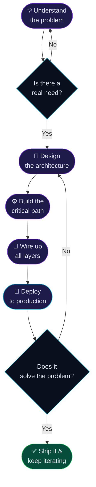

<!-- ═══════════════════ HEADER ═══════════════════ -->
<p align="center">
  
</p>

<p align="center">
  
</p>

<p align="center">
  <a href="https://arpit-mhjn1.github.io/arpit-portfolio/">
    
  </a>
  <a href="https://www.linkedin.com/in/arpitmahajan10">
    
  </a>
  <a href="mailto:mahajanarpit37@gmail.com">
    
  </a>
  <a href="https://arpit-mhjn1.github.io/arpit-portfolio/resume.pdf">
    
  </a>
</p>

<p align="center">
  
  &nbsp;
  
  &nbsp;
  
</p>

---

## `$ who is-- arpit`

```bash
{
  "name"        : "Arpit Mahajan",
  "title"       : "Full Stack Python Developer | AI & ML Engineer",
  "location"    : "Pathankot, Punjab, India 🇮🇳",
  "education"   : "B.Tech Computer Engineering (AI & ML) — ACET, 2023–2027",
  "open_to"     : ["Internships", "SWE Roles", "Collaborations"],

  "i_build"     : [
    "RAG pipelines with vector DBs (Qdrant, pgvector)",
    "FastAPI microservices & async backends",
    "Full-stack apps with React + TypeScript",
    "LLM-powered AI applications"
  ],
  "deployed_at" : "1,000+ active users | 99.9% uptime",
  "philosophy"  : "Ship it → learn from it → make it better.",
  "fun_fact"    : "My commit history tells more stories than my diary 📖"
}
```

---

## 🏆 Highlights

<p align="center">
  
  
  
  
</p>

---

## 🧭 My engineering mindset



---

## 🚀 Projects that ship

<div align="center">

| | Project | The problem it solves | Stack | Live |
|:-:|:--------|:---------------------|:------|:----:|
| 🧠 | **DOCLY — AI Doc Intelligence** | Research means reading 50 PDFs. DOCLY lets you *talk* to your documents — sub-100ms RAG queries, 96.4% faithfulness score, real-time streaming answers. | `FastAPI` · `Next.js` · `Qdrant` · `Redis` · `Celery` · `Docker` | [↗ Repo](https://github.com/Arpit-mhjn1) |
| 🎓 | **Campus Event Manager** | Manual registrations, paper tickets, admin chaos. This replaced all of it — 1,000+ active users, 99.9% uptime, automated PDF credentials. | `React` · `FastAPI` · `PostgreSQL` · `Render` | [↗ Demo](https://edc-event-manager-1.onrender.com/) |
| ☁️ | **Dropix Cloud** | A full-stack cloud storage platform — 5GB quota, JWT auth, sub-100ms API responses, SendGrid email integration. Deployed and usable by anyone. | `React` · `FastAPI` · `PostgreSQL` · `JWT` · `SendGrid` | [↗ Demo](https://dropix-6267.onrender.com/) |
| 🤖 | **AI Interview Coach** | Mock interviews that adapt to your *exact* role using LangChain + Groq Llama 3 — not generic questions, structured JSON pipelines with zero schema failures. | `Python` · `LangChain` · `Groq Llama 3` · `Streamlit` | [↗ Demo](https://ainterviewpreperation.streamlit.app/) |
| 🔥 | **Forest Fire Predictor** | Algerian meteorological data → trained ML classification → fire risk prediction. A full pipeline — EDA, feature engineering, trained model, deployed tool. | `Python` · `Scikit-Learn` · `Pandas` · `Streamlit` | [↗ Demo](https://algerian-forest-fire-prediction1.streamlit.app/) |
| 💳 | **Loan Management System** | A production-structured Spring Boot backend — layered architecture (Controller → Service → Repository), REST APIs, MySQL persistence. | `Java` · `Spring Boot` · `MySQL` | [↗ Repo](https://github.com/Arpit-mhjn1/Loan-Application-Management) |

</div>

<p align="center">
  <a href="https://arpit-mhjn1.github.io/arpit-portfolio/">
    
  </a>
</p>

---

## 🧰 What I work with

<div align="center">

**Languages**
<br/>


**Backend & Microservices**
<br/>


**Frontend**
<br/>


**Databases & Caching**
<br/>

&nbsp;


**AI / ML & Vector Retrieval**
<br/>

&nbsp;


**Tools & DevOps**
<br/>

&nbsp;


</div>

<details>
<summary><b>📂 Full skill breakdown (expand)</b></summary>
<br>

| Domain | Skills |
|:--------|:--------|
| **Languages** | Python (AsyncIO) · JavaScript (ES6+) · TypeScript · Java · C++ · C |
| **Frontend & Full Stack UI** | React.js · Next.js · Tailwind CSS · HTML5/CSS3 · State Management · WebSockets · Responsive UI/UX |
| **Backend & Microservices** | FastAPI · Flask · Node.js · RESTful APIs · Celery · Uvicorn · Pydantic · SQLAlchemy · Microservices Architecture |
| **AI, ML & Vector Retrieval** | LLMs · RAG Pipelines · LangChain · LlamaIndex · Qdrant Vector DB · pgvector · Groq LPU · Embeddings · NLP · Scikit-learn |
| **Databases & Caching** | PostgreSQL · Redis (Caching & Task Broker) · MySQL · Qdrant · MinIO · SQLite |
| **Cloud & DevOps** | Docker · Docker Compose · Render PaaS · Vercel · Git/GitHub · GitHub Pages |
| **Core CS** | System Design · End-to-End Full Stack Architecture · DSA · OOP · DBMS · Agile/Scrum |

</details>

---

## 🎓 Certifications

<div align="center">

| Certification | Issuer |
|:---|:---|
| The Joy of Computing Using Python | IIT Madras |
| Building AI Applications Using Python | LinkedIn Learning |
| MLOps Essentials: Model Deployment & Monitoring | LinkedIn Learning |
| Introduction to AI/ML | Pregrad |
| Career Skills in Software Development | Microsoft |
| Cloud Computing | IIT Kharagpur |

</div>

---

## 📡 Current mission

```diff
@@  What I'm focused on right now  @@

+ Building DOCLY: an end-to-end AI document intelligence platform
+ Deepening expertise in RAG, vector databases and LLM app architecture
+ Mastering Docker, Celery and async FastAPI microservices at scale
+ Grinding DSA and system design for SWE interview readiness

- Writing code that only lives on localhost
- Waiting for the "perfect" moment to start building
```

---

## 📊 GitHub analytics

<p align="center">
  
  
</p>

<p align="center">
  
</p>

<p align="center">
  
</p>

<p align="center">
  <picture>
    <source media="(prefers-color-scheme: dark)" srcset="https://raw.githubusercontent.com/Arpit-mhjn1/Arpit-mhjn1/output/github-contribution-grid-snake-dark.svg" />
    <source media="(prefers-color-scheme: light)" srcset="https://raw.githubusercontent.com/Arpit-mhjn1/Arpit-mhjn1/output/github-contribution-grid-snake.svg" />
    
  </picture>
</p>

---

## 🎧 Beyond the terminal

<p align="center">
  🎵 Music &nbsp;|&nbsp; 🏏 Cricket &nbsp;|&nbsp; 📖 Tech blogs &nbsp;|&nbsp; 🎮 Gaming &nbsp;|&nbsp; ✈️ Travelling &nbsp;|&nbsp; ☕ Chai-fuelled late-night builds
</p>

---

<h2 align="center">👋 Let's build something worth shipping</h2>

<p align="center">
  Got an idea? A collaboration? An internship opportunity?<br/>
  <b>I'm one message away.</b>
</p>

<p align="center">
  <a href="https://www.linkedin.com/in/arpitmahajan10">
    
  </a>
  <a href="https://arpit-mhjn1.github.io/arpit-portfolio/">
    
  </a>
  <a href="mailto:mahajanarpit37@gmail.com">
    
  </a>
  <a href="https://github.com/Arpit-mhjn1?tab=repositories">
    
  </a>
</p>

<p align="center">
  
</p>

<p align="center">
  
</p>
