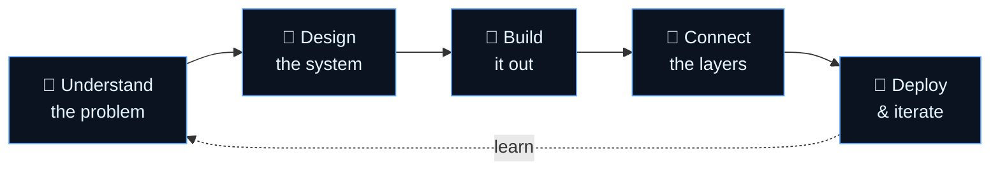

<!-- ═══════════════════════════  HEADER  ═══════════════════════════ -->
<p align="center">
  
</p>

<p align="center">
  <a href="https://arpit-mhjn1.github.io/arpit-portfolio/">
    
  </a>
</p>

<p align="center">
  <a href="https://arpit-mhjn1.github.io/arpit-portfolio/"></a>
  <a href="https://www.linkedin.com/in/arpitmahajan10"></a>
  <a href="mailto:mahajanarpit37@gmail.com"></a>
</p>

<p align="center">
  
  
  
</p>

---

## 🧬 `whoami`

<table>
<tr>
<td width="58%" valign="top">

Hey, I'm **Arpit** 👋, an aspiring Software Engineer who builds **practical, end-to-end applications** — things where AI, backend engineering and usable interfaces actually fit together and get deployed.

I care less about a flashy demo and more about the **whole system** around it:

- 🔎 **Ship working software.** A project isn't done until it's deployed and usable.
- 🧱 **Keep it modular.** Good separation means you can fix one thing without breaking three others.
- 🛟 **Plan for failure.** APIs go down, models hallucinate — build so the app handles it.
- 🎯 **Solve a real problem.** If nobody needs it, build it differently.

</td>
<td width="42%" valign="top">

```python
class Arpit:
    role     = "Aspiring Software Engineer"
    location = "India 🇮🇳"

    focus = [
        "AI/ML Applications",
        "Java & Spring Boot",
        "Full Stack Web Dev",
        "LLMs & Groq AI",
        "Cloud Deployments",
    ]

    def philosophy(self):
        return ("Code that ships and works "
                "beats perfect code that "
                "lives only on localhost.")
```

</td>
</tr>
</table>

---

## ⚙️ How I build



| Stage | What it means | Seen in |
| :-- | :-- | :-- |
| 🎯 **Understand** | Define the core user problem before picking any tool or framework | **AI Interview Coach**: the real value wasn't just questions — it was role-specific, real-time feedback |
| 📐 **Design** | Plan the data flow, API contracts and boundaries before writing code | **Loan Management**: Spring Boot layers (Controller → Service → Repository) designed first, coded second |
| 🧪 **Build** | Build the critical path first; get one flow working end-to-end | **Forest Fire Predictor**: cleaned data → feature pipeline → model → Streamlit UI, one stage at a time |
| 🔌 **Connect** | Wire the backend, ML model and UI through clean, documented interfaces | **Dropix Cloud**: REST endpoints → auth middleware → file storage → responsive frontend |
| 🚀 **Deploy** | Ship to a real URL, handle environment differences, make it accessible | **Campus Event Manager**: CI/CD-free deployment to Render with environment config handled gracefully |

---

## 🚀 Featured projects

> Six builds. Six different problems. One rule: **if it isn't deployed and working, it isn't finished.**

### ⚡ Quick view

| # | Project | What it solves | Core tech | Link |
| :-: | :-- | :-- | :-- | :-: |
| 01 | 🤖 **AI Interview Coach** | Generates role-specific mock questions and gives real-time AI feedback | `Python` `Streamlit` `Groq Llama 3` | [Live ↗](https://ainterviewpreperation.streamlit.app/) |
| 02 | 🔥 **Forest Fire Predictor** | Predicts Algerian forest fire risk from meteorological data with ML | `Python` `Scikit-Learn` `Streamlit` | [Live ↗](https://algerian-forest-fire-prediction1.streamlit.app/) |
| 03 | 💳 **Loan Management System** | Enterprise-grade loan processing and approval with a secure Spring Boot backend | `Java` `Spring Boot` `MySQL` | [Repo ↗](https://github.com/Arpit-mhjn1/Loan-Application-Management) |
| 04 | ☁️ **Dropix Cloud** | Cloud file-sharing with user authentication and secure shareable links | `Web App` `Cloud` `Auth` | [Live ↗](https://dropix-6267.onrender.com/) |
| 05 | 🎓 **Campus Event Manager** | Full-stack system to create, organize and track university campus events | `Full Stack` `Database` | [Live ↗](https://edc-event-manager-1.onrender.com/) |
| 06 | 📚 **Library Management** | Streamlined library system for inventory, borrowings and user management | `HTML` `CSS` `JavaScript` | [Repo ↗](https://github.com/Arpit-mhjn1/Library-Management-System) |

> 💡 *Check out the complete interactive showcase on my* [**personal portfolio website**](https://arpit-mhjn1.github.io/arpit-portfolio/).

### 🔍 Deep dive

<!-- ───────────── 01 ───────────── -->
### `01` 🤖 AI Interview Coach &nbsp;·&nbsp; <sub>AI-powered mock interview platform using LLMs</sub>

> *Role-specific questions. Real-time feedback. Zero fluff.*

Users select a job role and get **dynamically generated interview questions from Groq's Llama 3**, covering technical depth, behavioural patterns and domain knowledge. The system gives **instant AI feedback** on answers — not just right/wrong, but *why*. Built with Streamlit for a clean, zero-install experience and deployed publicly.

```
job role ─▶ Groq Llama 3 prompt ─▶ dynamic questions ─▶ user answer ─▶ AI evaluation ─▶ feedback
```

**🛠️ Stack:** `Python` `Streamlit` `Groq API` `Llama 3` `LLM Prompt Engineering`<br/>
🔗 [**Live Demo**](https://ainterviewpreperation.streamlit.app/)

<!-- ───────────── 02 ───────────── -->
### `02` 🔥 Forest Fire Predictor &nbsp;·&nbsp; <sub>ML-powered fire risk classification system</sub>

> *Real data. Trained model. Deployed prediction.*

Trained on the **Algerian Forest Fires dataset**, this system takes meteorological inputs (temperature, humidity, wind speed, rain, BUI, FWI indices) and predicts fire risk class. Built a **full ML pipeline**: EDA → feature engineering → model selection (Scikit-Learn) → hyperparameter tuning → Streamlit deployment. The model is serialized and loaded at runtime — no retraining needed per request.

```
raw data ─▶ EDA & cleaning ─▶ feature engineering ─▶ model training ─▶ serialized model ─▶ Streamlit API
```

**🛠️ Stack:** `Python` `Scikit-Learn` `Pandas` `NumPy` `Pickle` `Streamlit`<br/>
🔗 [**Live Demo**](https://algerian-forest-fire-prediction1.streamlit.app/)

<!-- ───────────── 03 ───────────── -->
### `03` 💳 Loan Management System &nbsp;·&nbsp; <sub>Enterprise Spring Boot backend application</sub>

> *Built for reliability, designed for scale.*

A production-structured **Spring Boot** application handling the complete loan lifecycle: application submission, eligibility checks, approval workflows, EMI calculation and status tracking. Uses a clean **layered architecture** (Controller → Service → Repository) with MySQL persistence, DTOs, exception handling and RESTful API contracts. Designed to reflect enterprise Java patterns.

```
loan request ─▶ eligibility check ─▶ approval workflow ─▶ EMI calculation ─▶ MySQL persistence ─▶ REST API
```

**🛠️ Stack:** `Java` `Spring Boot` `Spring Data JPA` `MySQL` `REST APIs` `Maven`<br/>
🔗 [**Repository**](https://github.com/Arpit-mhjn1/Loan-Application-Management)

<!-- ───────────── 04 ───────────── -->
### `04` ☁️ Dropix Cloud &nbsp;·&nbsp; <sub>Cloud file-sharing web application</sub>

> *Upload. Share. Done.*

A responsive cloud file-sharing platform where users can **upload files, generate secure shareable links** and manage their cloud storage through a clean interface. Implements **user authentication**, file ownership, link expiry controls and a dashboard. Deployed live on Render with persistent storage.

```
file upload ─▶ auth check ─▶ cloud storage ─▶ secure link generation ─▶ shareable URL ─▶ dashboard
```

**🛠️ Stack:** `Web App` `Authentication` `Cloud Storage` `Render`<br/>
🔗 [**Live Demo**](https://dropix-6267.onrender.com/)

<!-- ───────────── 05 ───────────── -->
### `05` 🎓 Campus Event Manager &nbsp;·&nbsp; <sub>Full-stack university event management system</sub>

> *Every event, organized.*

A comprehensive system for **creating, managing and tracking campus events**. Features event creation with descriptions and schedules, registration flows for students, organizer dashboards and status tracking. Built full-stack and deployed live on Render, handling real university event coordination workflows.

```
event creation ─▶ registration flow ─▶ attendee tracking ─▶ organizer dashboard ─▶ status management
```

**🛠️ Stack:** `Full Stack` `Database` `Render` `REST APIs`<br/>
🔗 [**Live Demo**](https://edc-event-manager-1.onrender.com/)

<!-- ───────────── 06 ───────────── -->
### `06` 📚 Library Management &nbsp;·&nbsp; <sub>Browser-based library system</sub>

> *Simple interface. Complete functionality.*

A client-side **library management system** for tracking inventory, managing borrowings and returns, and searching the catalogue — all without a backend. Pure HTML, CSS and JavaScript, with localStorage persistence. Demonstrates clean DOM management, state handling and UI design principles.

```
book search ─▶ borrow/return flow ─▶ inventory update ─▶ localStorage persistence ─▶ dashboard view
```

**🛠️ Stack:** `HTML5` `CSS3` `JavaScript` `localStorage`<br/>
🔗 [**Repository**](https://github.com/Arpit-mhjn1/Library-Management-System)

<br/>

<p align="center">
  <a href="https://arpit-mhjn1.github.io/arpit-portfolio/"></a>
</p>

---

## 🧠 Where my skills meet real builds

| Capability | Where it's built |
| :-- | :-- |
| 🤖 **LLM & Generative AI Apps** | AI Interview Coach |
| 🔬 **Machine Learning Pipelines** | Forest Fire Predictor |
| ☕ **Enterprise Java / Spring Boot** | Loan Management System |
| ☁️ **Cloud & File Systems** | Dropix Cloud |
| 📅 **Full-Stack Web Development** | Campus Event Manager |
| 🗄️ **Database Design & SQL** | Loan Management · Library Management |
| 🎨 **Frontend (HTML/CSS/JS)** | Library Management · Dropix Cloud |

---

## 🧰 Tech arsenal

<p align="center">
  <br/>
  <br/>
  
</p>

<details>
<summary><b>📂 Full skill list (click to expand)</b></summary>
<br/>

| Area | Skills |
| :-- | :-- |
| **Languages** | Python · Java · C++ · C · JavaScript |
| **Backend & APIs** | Spring Boot · Spring Data JPA · REST APIs · Maven · JWT Auth |
| **AI / ML** | Scikit-Learn · Pandas · NumPy · Feature Engineering · LLM Prompt Engineering |
| **Generative AI** | Groq API · Llama 3 · LLMs · AI-powered applications |
| **Frontend** | HTML5 · CSS3 · JavaScript · Streamlit · Responsive Design |
| **Databases** | MySQL · SQL · localStorage |
| **DevOps & Cloud** | Git · GitHub · Render · Vercel · GitHub Pages |
| **Tools** | VS Code · Jupyter Notebook · Pickle · REST client testing |

</details>

---

## 📊 GitHub analytics & top languages

<p align="center">
  
  
</p>

<p align="center">
  
</p>

<p align="center">
  
</p>

<p align="center">
  <picture>
    <source media="(prefers-color-scheme: dark)" srcset="https://raw.githubusercontent.com/Arpit-mhjn1/Arpit-mhjn1/output/github-contribution-grid-snake-dark.svg"/>
    <source media="(prefers-color-scheme: light)" srcset="https://raw.githubusercontent.com/Arpit-mhjn1/Arpit-mhjn1/output/github-contribution-grid-snake.svg"/>
    
  </picture>
</p>

---

## 🔭 Right now

```diff
+ Deepening my Java & Spring Boot skills with microservices patterns
+ Exploring LangChain and RAG for more powerful AI app architectures
+ Sharpening DSA problem solving for SWE interview readiness
+ Open to internships, collaborative projects and anything interesting
```

## 🌱 Beyond the code

<p>
  🎵 Music &nbsp;·&nbsp; 🏏 Cricket &nbsp;·&nbsp; 📖 Tech Blogs &nbsp;·&nbsp; 🎮 Gaming &nbsp;·&nbsp; ✈️ Exploring new places
</p>

---

<h2 align="center">🤝 Let's connect and build something great!</h2>

<p align="center">
  Always up for conversations about <b>AI/ML products, Java systems, full-stack projects</b><br/>
  and <i>ideas worth shipping</i>.
</p>

<p align="center">
  <a href="https://www.linkedin.com/in/arpitmahajan10"></a>
  <a href="https://arpit-mhjn1.github.io/arpit-portfolio/"></a>
  <a href="mailto:mahajanarpit37@gmail.com"></a>
  <a href="https://github.com/Arpit-mhjn1?tab=repositories"></a>
</p>

<p align="center">
  
</p>

<p align="center">
  
</p>
